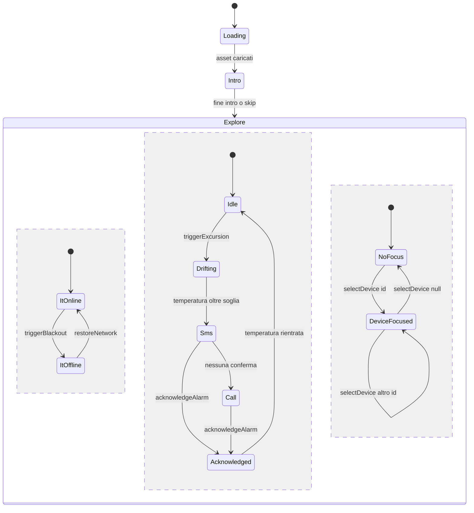

# CrossCheck OOB

Presentazione interattiva del sistema **CrossCheck OOB**, un monitoraggio termico di backup per frigoriferi farmaceutici. Un sensore interno LoRa resta in ascolto dentro il frigo di metallo e parla con un gateway esterno cellulare, anche quando la rete IT è spenta.

L'app è una singola scena 3D ospitata su GitHub Pages, senza backend.

## Stack

- React + TypeScript
- React Three Fiber e `@react-three/drei`
- Zustand per lo stato client
- Vite
- `@react-three/postprocessing` per Bloom e Depth of Field
- `gltf-transform` per l'ottimizzazione dei modelli

## Decisioni

- **Estetica prima del dettaglio.** I dispositivi sono stilizzati e generici: forme pulite, plastica opaca chiara, un LED ciascuno. Nessun CAD, nessuna scheda tecnica a schermo. Il frigo in acciaio è l'unico oggetto con materiali ricchi.
- **Diorama minimale.** Fondo scuro, una pedana, una parete di fondo e una mensola per router e gateway. Non è una stanza realistica.
- **Tre colori, tre significati.** Un colore d'accento per il canale OOB, grigio neutro per il Wi-Fi, rosso riservato all'allarme.
- **Zustand, non Context.** I componenti 3D leggono lo stato dentro il frame loop con `getState()` senza provocare re-render, e la logica temporizzata vive fuori da React.
- **Scenari non esclusivi.** Blackout IT e sbalzo termico sono due assi indipendenti. La loro combinazione (rete giù e allarme che arriva comunque) è il momento più forte della demo.
- **Timeline fuori dai componenti.** Un modulo "director" possiede i timer delle sequenze. I componenti reagiscono solo allo stato.
- **Pop-up nel DOM.** Nella scena restano solo gli hotspot. Il pannello informativo è HTML sovrapposto, così il testo è nitido, accessibile e adattabile al mobile.
- **Un `.glb` per dispositivo**, più un file per il diorama.
- **Tutto self-hosted.** Decoder Draco e HDRI stanno in `public/`. I default di drei puntano a CDN esterne, da evitare in produzione.
- **Solo italiano.** I testi vivono in `content/it.ts`.
- **Nessun sesto dispositivo.** Il router è l'unico elemento IT. L'HUD mostra "Rete IT: offline" durante il blackout.
- **La radiofrequenza è una metafora visiva.** Le onde Wi-Fi si fermano sull'acciaio, il segnale OOB passa. Nessuna frequenza o valore tecnico a schermo.

## Valori dimostrativi

Sono illustrativi, non dati di prodotto, e stanno tutti in `config/scenarios.ts`.

| Parametro | Valore |
|---|---|
| Range nominale | 2–8 °C |
| Picco dello sbalzo | 12 °C |
| Durata della sequenza d'allarme | circa 12 secondi |

## Alberatura

```
3d-env/
├─ .github/workflows/deploy.yml   # build + deploy su GitHub Pages
├─ public/
│  ├─ models/                     # .glb ottimizzati (output della pipeline)
│  ├─ textures/                   # schermate del telefono, lightmap
│  ├─ hdri/                       # environment map .hdr 1k
│  └─ draco/                      # decoder Draco
├─ assets-src/                    # .blend e GLB grezzi (non deployati)
├─ scripts/optimize-models.mjs    # pipeline gltf-transform
├─ src/
│  ├─ main.tsx
│  ├─ App.tsx
│  ├─ config/                     # devices, scenarios, cameraPresets, quality, assets
│  ├─ content/                    # testi di pop-up e HUD (it.ts)
│  ├─ store/                      # types, simulationSlice, uiSlice, selectors
│  ├─ simulation/                 # director, timelines, temperatureModel
│  ├─ scene/                      # tutto ciò che vive dentro <Canvas>
│  │  ├─ SceneCanvas.tsx
│  │  ├─ devices/                 # Fridge, Sensor, Gateway, Router, Smartphone
│  │  ├─ links/                   # SignalLink, RfWavefront
│  │  ├─ staging/                 # Room, Lighting, CameraRig
│  │  ├─ interaction/             # Hotspot, useDeviceInteraction
│  │  ├─ materials/
│  │  └─ effects/                 # Bloom, DoF, tone mapping
│  ├─ ui/                         # tutto ciò che è DOM
│  │  ├─ layout/  scenario/  hud/  info/  phone/  loader/
│  └─ styles/
├─ index.html
├─ vite.config.ts
└─ package.json
```

`scene/` e `ui/` non si importano mai a vicenda. Entrambi dipendono solo da `store/`, `config/` e `content/`.

## Vite e GitHub Pages

- Il remote è `GiuseppePuleri/ccoob.github.io`, quindi `base` è `/ccoob.github.io/`. Ogni URL di asset si costruisce da `import.meta.env.BASE_URL`.
- Il sito risultante è `https://giuseppepuleri.github.io/ccoob.github.io/`. L'indirizzo `ccoob.github.io` funzionerebbe solo se il repository appartenesse a un account chiamato `ccoob`; in quel caso `base` diventerebbe `/`.
- Nessun router: è una singola vista. Se servono deep link agli scenari, si usa l'hash.
- `SceneCanvas` è caricato in lazy e `three` sta in un chunk separato, così loader e UI compaiono subito.
- Il deploy passa da GitHub Actions con `actions/deploy-pages`, senza un branch `gh-pages` manuale.

## Stato

```ts
type DeviceId = 'fridge' | 'sensor' | 'gateway' | 'router' | 'smartphone';
type LinkId = 'lora' | 'cellular' | 'wifi';
type LinkStatus = 'active' | 'alert' | 'down';
type ItNetwork = 'online' | 'offline';
type AlarmPhase = 'idle' | 'drifting' | 'sms' | 'call' | 'acknowledged';
type AppPhase = 'loading' | 'intro' | 'explore';
type QualityTier = 'low' | 'high';

interface SimulationState {
  itNetwork: ItNetwork;
  alarmPhase: AlarmPhase;      // 'idle' equivale a funzionamento normale
  temperatureC: number;        // arrotondata a 0,1 °C, aggiornata a ~4 Hz
}

interface SimulationActions {
  triggerBlackout(): void;
  restoreNetwork(): void;
  triggerExcursion(): void;
  acknowledgeAlarm(): void;
  reset(): void;
  // riservate al director
  setAlarmPhase(phase: AlarmPhase): void;
  setTemperature(celsius: number): void;
}

interface UiState {
  appPhase: AppPhase;
  selectedDevice: DeviceId | null;   // pop-up aperto
  hoveredDevice: DeviceId | null;
  quality: QualityTier;
  reducedMotion: boolean;
}

interface UiActions {
  selectDevice(id: DeviceId | null): void;
  hoverDevice(id: DeviceId | null): void;
  finishIntro(): void;
  setQuality(tier: QualityTier): void;
}

type AppStore = SimulationState & SimulationActions & UiState & UiActions;
```

Lo stato dei collegamenti non viene memorizzato. Lo deriva il selettore `selectLinkStatus(state, linkId)`.

| Scenario | Wi-Fi (router) | LoRa (sensore–gateway) | Cellulare (gateway–smartphone) |
|---|---|---|---|
| Base | active | active | active |
| Blackout IT | down | active | active |
| Sbalzo termico | active | alert | alert |
| Blackout + sbalzo | down | alert | alert |

```ts
interface CameraPreset { position: [number, number, number]; target: [number, number, number]; }

interface DeviceConfig {
  id: DeviceId;
  modelUrl: string;
  hotspotAnchor: [number, number, number];
  cameraPreset: CameraPreset;
}

interface DeviceContent {
  title: string;
  tagline: string;
  body: string;
}

interface TimelineStep { atMs: number; phase: AlarmPhase; }

interface ThermalConfig { nominalC: number; minC: number; maxC: number; excursionPeakC: number; }

interface QualitySettings {
  dpr: [number, number];
  multisampling: number;
  bloom: boolean;
  depthOfField: boolean;
}
```

`high` ha Bloom e Depth of Field. `low` ha solo Bloom.

## Diagramma di stato



Le tre regioni dentro `Explore` sono parallele: rete IT, ciclo d'allarme e focus sul dispositivo. `reset` riporta tutte e tre allo stato iniziale da qualunque punto e annulla i timer del director.

Il superamento della soglia fa partire direttamente l'SMS. Dopo la conferma la temperatura rientra e si torna a `idle`.

## Componenti

### Scena (R3F)

| Componente | Responsabilità | Legge dallo store |
|---|---|---|
| `SceneCanvas` | Canvas, dpr, Suspense, monitor delle prestazioni | `quality` |
| `CameraRig` | Orbita vincolata e transizioni verso i preset | `selectedDevice`, `alarmPhase` |
| `Room`, `Lighting` | Diorama con luce baked, HDRI, luce d'allarme | `alarmPhase` |
| `Fridge` | Apertura porta, scocca semitrasparente per mostrare il sensore | `selectedDevice`, `alarmPhase` |
| `Sensor`, `Gateway`, `Router` | LED emissivi secondo lo stato del proprio link | `selectLinkStatus` |
| `Smartphone` | Cambio texture schermo, vibrazione | `alarmPhase` |
| `SignalLink` | Impulsi lungo il collegamento, colore per stato | `selectLinkStatus` |
| `Hotspot` | Marcatore cliccabile per dispositivo | `hoveredDevice`, `selectedDevice` |
| `Effects` | Bloom, DoF, tone mapping | `quality`, `selectedDevice` |

Ogni dispositivo riceve solo `{ id: DeviceId }` e si abbona ai propri selettori. `SignalLink` riceve `{ id: LinkId; from: DeviceId; to: DeviceId }`.

### UI (DOM)

| Componente | Responsabilità |
|---|---|
| `ScenarioPanel` | Pulsanti blackout, sbalzo termico, reset |
| `StatusHud` | Temperatura corrente e stato dei tre link |
| `DeviceInfoPanel` | Pop-up del dispositivo selezionato, testi da `content/` |
| `PhoneNotification` | SMS e chiamata in formato leggibile, con "Conferma" |
| `DeviceNav` | Elenco dei dispositivi come pulsanti, alternativa da tastiera agli hotspot |
| `Loader`, `WebglFallback` | Avanzamento del caricamento, immagine statica se WebGL manca |

## UX

- Dopo il caricamento, una breve panoramica di camera presenta i cinque elementi, poi l'utente esplora liberamente.
- L'orbita ha limiti di angolo e zoom, mai volo libero. Il clic su un dispositivo porta la camera al suo preset.
- **Blackout IT:** i LED del router si spengono e il collegamento Wi-Fi sparisce. LoRa e cellulare continuano a pulsare, e l'HUD lo dichiara in chiaro.
- **Sbalzo termico:** la temperatura sale nell'HUD, il frigo emette una luce rossa e gli impulsi passano ad ambra e rosso. La camera va sullo smartphone, dove arrivano prima l'SMS e poi la chiamata.
- **Gabbia di Faraday:** in focus sul frigo la scocca diventa semitrasparente. I fronti d'onda Wi-Fi si smorzano contro l'acciaio, quelli OOB escono attenuati ma visibili.
- Su desktop l'HUD è in alto, gli scenari in basso e il pannello info a destra. Su mobile il pannello info diventa un bottom sheet.
- Con `prefers-reduced-motion` le transizioni di camera diventano tagli, e l'allarme è annunciato con `aria-live`.

## Modelli 3D

Convenzioni comuni: 1 unità = 1 metro, Y in alto, trasformazioni applicate, origine alla base del modello. I nomi dei nodi sono un contratto con il codice e non vanno cambiati senza aggiornare `config/`.

| File | Triangoli (target) | Texture | Nodi obbligatori |
|---|---|---|---|
| `fridge.glb` | 30–40k | 2k: base color, normal, ORM | `Fridge_Body`, `Fridge_Door` (pivot sulla cerniera), `Fridge_Gasket`, `Fridge_Interior`, `Fridge_Shelves` |
| `sensor.glb` | 3–5k | nessuna | `Sensor_Body`, `Sensor_Probe`, `Sensor_LED` |
| `gateway.glb` | 4–6k | nessuna | `Gateway_Body`, `Gateway_Antenna_LoRa`, `Gateway_Antenna_LTE`, `Gateway_LED_Power`, `Gateway_LED_LoRa`, `Gateway_LED_Cell` |
| `router.glb` | 3–5k | nessuna | `Router_Body`, `Router_Antenna`, `Router_LED_Power`, `Router_LED_WiFi` |
| `smartphone.glb` | 3–5k | nessuna | `Phone_Body`, `Phone_Screen` (materiale separato, UV 0–1 a tutto schermo) |
| `room.glb` | 5–10k | lightmap 1k su UV2 | `Room_Floor`, `Room_Walls`, `Room_Props` |

- Ogni LED è una mesh separata con materiale proprio, così il codice ne pilota l'emissività.
- Nessuna clip di animazione nel `.glb`. Porta del frigo e vibrazione del telefono sono guidate dal codice: basta che i pivot siano corretti.
- Le schermate del telefono sono tre texture separate in `public/textures/`: blocco, SMS, chiamata in arrivo.
- Le fiale nel frigo sono una sola mesh, replicata in instancing dal codice.
- Solo il frigo usa texture. Gli altri dispositivi hanno colori PBR piatti.

I conteggi di triangoli sono budget da tarare sui dispositivi target.

## Pipeline degli asset

1. Export da Blender in glTF binario, senza compressione, dentro `assets-src/`.
2. `scripts/optimize-models.mjs` con `gltf-transform` esegue dedup, prune, weld, ridimensionamento texture, compressione Draco e scrive in `public/models/`.
3. `gltfjsx --types` genera lo scheletro di ogni componente dispositivo.

Draco comprime solo la geometria. Le texture restano poche (frigo e schermate del telefono), quindi non serve KTX2. Budget indicativo: sotto i 5 MB complessivi tra modelli e texture.

### Acciaio

- Metalness 1, roughness 0,25–0,4, con una roughness map che introduce satinatura direzionale e leggere impronte.
- Un metallo è quasi solo riflesso: senza una buona HDRI da studio appare nero. L'environment map è l'asset più importante per il frigo.
- La guarnizione della porta è un materiale dielettrico opaco. Il contrasto con l'acciaio rende leggibile il punto da cui il segnale esce.

### Baking

- Una sola lightmap 1k per il diorama, baked in Cycles su un secondo canale UV, ombre statiche incluse.
- Sul frigo si fa il baking solo dell'ambient occlusion. La luce baked su un metallo è sbagliata, perché i riflessi dipendono dal punto di vista.
- Il blackout IT non cambia l'illuminazione. La luce d'allarme è dinamica e senza ombre.
- Se manca tempo per il baking in Blender, `ContactShadows` e `AccumulativeShadows` di drei, calcolate una volta, sono un ripiego accettabile.

### Post-processing

- **Bloom selettivo:** soglia di luminanza a 1, e solo i materiali emissivi con intensità sopra 1 e `toneMapped` disattivato brillano. Si accendono LED, impulsi e allarme, non l'acciaio.
- **Depth of Field:** attivo solo in focus su un dispositivo, con il fuoco sul dispositivo selezionato. È l'effetto più costoso e resta spento nel livello `low`.
- **Tone mapping:** ultimo effetto della catena, non sul renderer.
- **Qualità adattiva:** `PerformanceMonitor` di drei scende a `low` se il frame rate cala. Dpr massimo 2 su desktop e 1,5 su mobile.

## Prima dello sviluppo

Node non è installato in questa macchina. Homebrew c'è: serve Node LTS da lì prima dello scaffolding.
